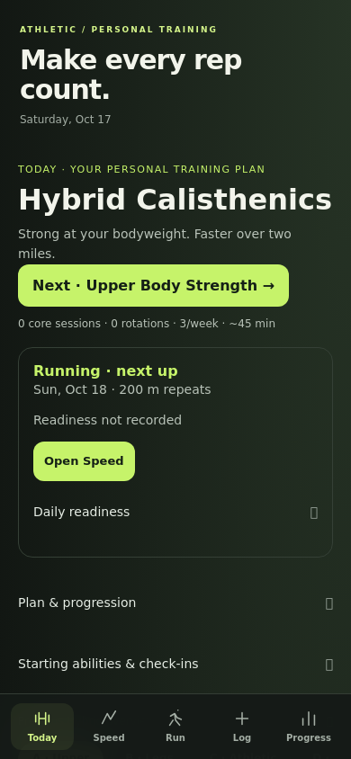
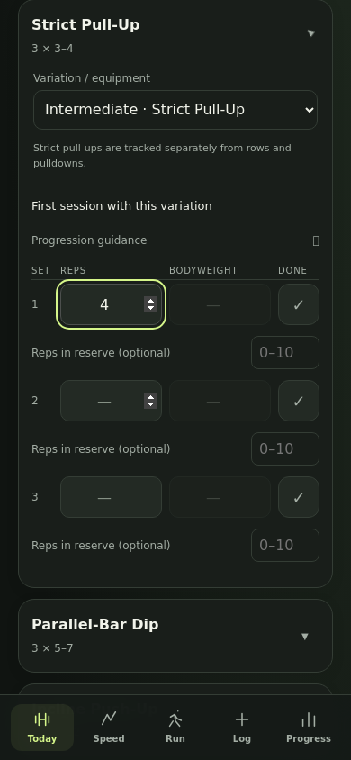
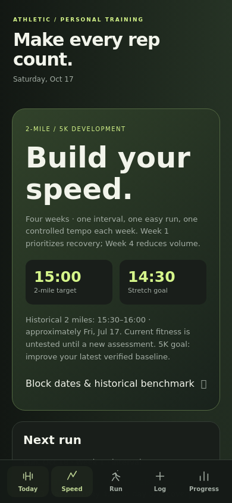
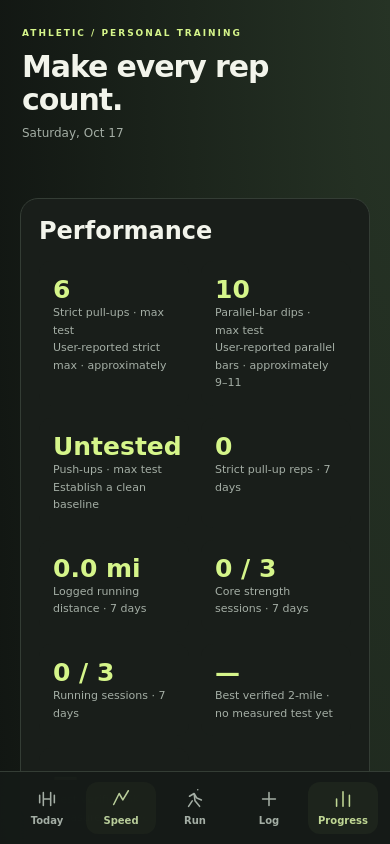

# Hybrid Calisthenics upgrade

Athletic’s primary plan is now Hybrid Calisthenics. The five bottom destinations are Today, Speed, Run, Log and Progress. This remains a static, personal, browser-only PWA with no new runtime dependencies, services or accounts.

## Personal plan

- A: pull-ups, parallel-bar dips, push-ups, rows, pike push-ups/pressing and frog crunches.
- B: split squats, Romanian deadlifts, step-ups/lunges, calves, tibialis/step-downs and knee raises/reverse crunches.
- C: chin-ups, push-ups, squats, rows, hollow/hanging core and frog crunches.
- D: optional easy mobility, hangs and technique practice; it never advances the main rotation.

The editable initial baselines are six strict pull-ups, approximately 9–11 parallel-bar dips (10 stored as the representative value), and an unknown push-up maximum. Working prescriptions start at 3 × 3–4 pull-ups and 3 × 5–7 dips. Push-ups start with comfortable incline technique work and a reminder to establish a clean baseline. The default schedule is three primary sessions plus an optional fourth, with a preferred 45-minute strength session.

Equipment modes and individual availability are remembered per workout. Changing availability preserves all entered sets and the plan rotation; equipment advice identifies useful substitutes. The exercise selector remains a deliberate manual override, including when equipment is marked unavailable. Selecting a different exercise confirms before clearing only that exercise’s entered sets. Bench dips are excluded from parallel-bar dip comparisons. Band tension is not assigned an invented pound value.

Each variation has its own performance history. Maximum tests are separate from working sets, and users can distinguish reported baselines from measured strict tests. Progression suggestions require two qualifying sessions on different calendar days, completed upper-range sets, controlled full range, at least two reps in reserve, easy/moderate difficulty, fresh/normal session recovery, suitable equipment and no current heavy/sore readiness flag. Missing feedback does not qualify. No recommendation automatically changes the selected variation or adds weight, including after a max-test edit.

Unfinished sessions reuse the existing draft system. New sessions add optional RIR, technique, difficulty, recovery and volume feedback, exercise-specific rest periods, and a completion receipt. A reduced-volume option records the choice while the user adjusts actual sets manually. Weekly strict pull-up totals exclude assisted and substitute movements. Earlier goal-strip values remain available under Earlier goals & estimates, distinct from verified assessments. Weekly mileage uses logged distances, including manually logged 400 m repeats, without estimating mileage for time-only runs. Weighted records show external added load relative to the bodyweight recorded with the workout, rather than an estimated 1RM.

## Running and recovery

The active four-week block introduces controlled 200 m, 400 m and 800 m repeats, followed by lower volume and a two-mile assessment. Each week includes an easy run and a controlled tempo; week one favors recent-race recovery, and week four uses an assessment in place of tempo. Warm-ups, cooldowns, repeat recoveries and run/walk alternatives are included.

Historical two-mile performance (15:30–16:00, approximately July 2026) is editable context, never a current pace prescription. The latest measured 2-mile or 5K result recalibrates estimated interval/tempo ranges; each distance retains its own verified baseline. Effort and recovery take priority over calculated ranges. Targets are 15:00 for two miles, 14:30 as a stretch, and improvement from the latest measured 5K baseline.

The suggested rhythm places intervals after the upper-body day, legs afterward, and about 48 hours between the full-body session and tempo. Users can reschedule, skip or shorten sessions. Missed sessions stay in the past rather than accumulating catch-up work. Completed/shortened Speed sessions store actual distance, time and optional repeat splits in the existing Run/Progress history. Resaving replaces that session rather than duplicating it. Assessment entries record the benchmark only; users log the underlying workout once through Speed, Run or GPS. A Speed assessment is not automatically declared verified merely because it was scheduled.

Heavy/sore readiness flags prompt reassessment without rewriting the plan. Today includes a quick readiness check-in. Sleep, notes and morning-weight trends continue using the existing readiness records. Speed links to the complete reusable Race Prep screen, including its original checklist history. The existing EMOM/conditioning screen remains available from Run.

## Storage and offline compatibility

Existing `trainingLog`, PR, goals, GPS, manual-workout and Race Prep keys retain their identities. The previous Hybrid exercise IDs and panels remain available under Previous routines; existing unfinished drafts are not reinterpreted as calisthenics exercises.

Two additive, versioned records are introduced: `athleticCalisthenicsV1` and `athleticSpeedV1`. New workout entries carry versioned plan/variation metadata, optional RIR and session feedback. Backups include both new records. No destructive migration is required. All data remains scoped to the current browser/device; there is no account sync.

The service-worker cache advances from v8 to v9 and precaches both new scripts. GPS remains foreground-only, with the existing pause/recovery behavior when iOS suspends the page. Manual run and ruck logging are unchanged.

## Validation

Run the tests sequentially. Browser tests use Playwright; the legacy mobile test uses jsdom. Install these as development tools outside the app or use an existing runtime:

```sh
npm install --prefix /tmp/athletic-tests playwright@1.51.1 jsdom@26.1.0
/tmp/athletic-tests/node_modules/.bin/playwright install --with-deps chromium
export NODE_PATH=/tmp/athletic-tests/node_modules
node tests/mobile.cjs
node tests/manual.cjs
node tests/outdoor.cjs
node tests/hybrid.cjs
node tests/race.cjs
node tests/calisthenics.cjs
node tests/pwa-upgrade.cjs
```

`CHROME_PATH` may select an existing Chromium executable. Tests cover previous data and draft recovery, all exercise variants/load modes, equipment changes without reset, manual overrides, progression safeguards, assessments/paces, running statuses/splits, GPS, rucks, Race Prep, save failures, duplicate prevention and mobile overflow at 320, 375, 390, 393 and 430 px. The PWA upgrade test serves the actual v8 files from commit `15204312`, installs the new worker and verifies old-cache cleanup, retained data and offline navigation.

Automated mobile screenshots below show the actual browser rendering. Physical-device Safari review remains part of the requested user review before merge.

| Today | Workout |
|---|---|
|  |  |

| Speed | Progress |
|---|---|
|  |  |

Training principles consulted: [ACSM progression position stand](https://pubmed.ncbi.nlm.nih.gov/19204579/) and the [American Heart Association’s talk-test guidance](https://www.heart.org/-/media/Files/Affiliates/WSA/Oregon/OR-Hard-Hats-Physical/Physical-Activity-Recommendations.pdf). The four-week calendar and conservative pace estimates are this app’s personal starter block.
